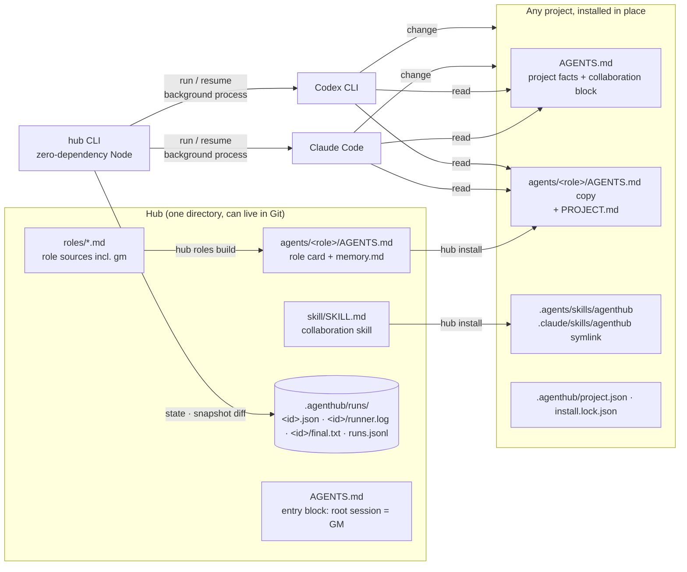
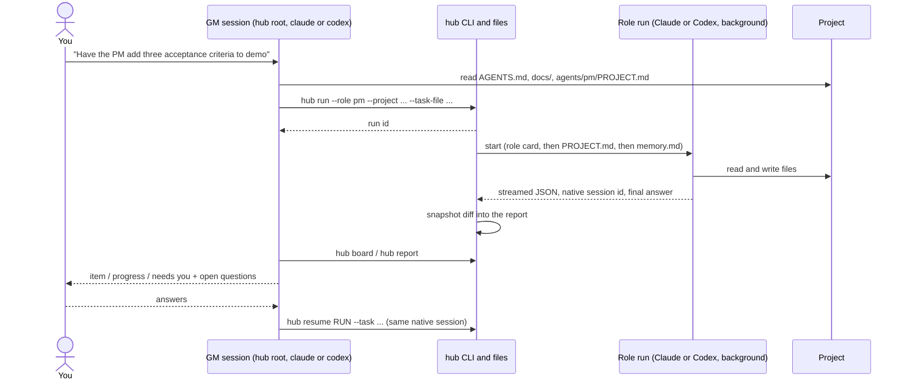
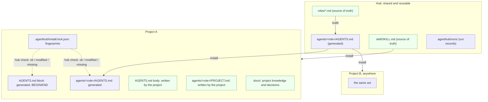
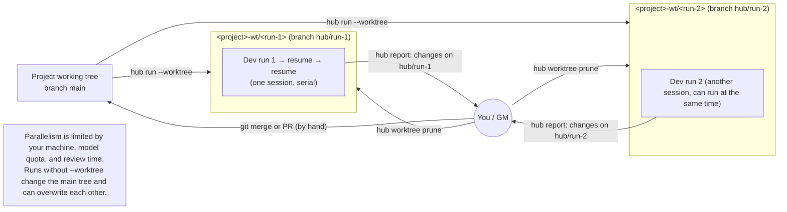
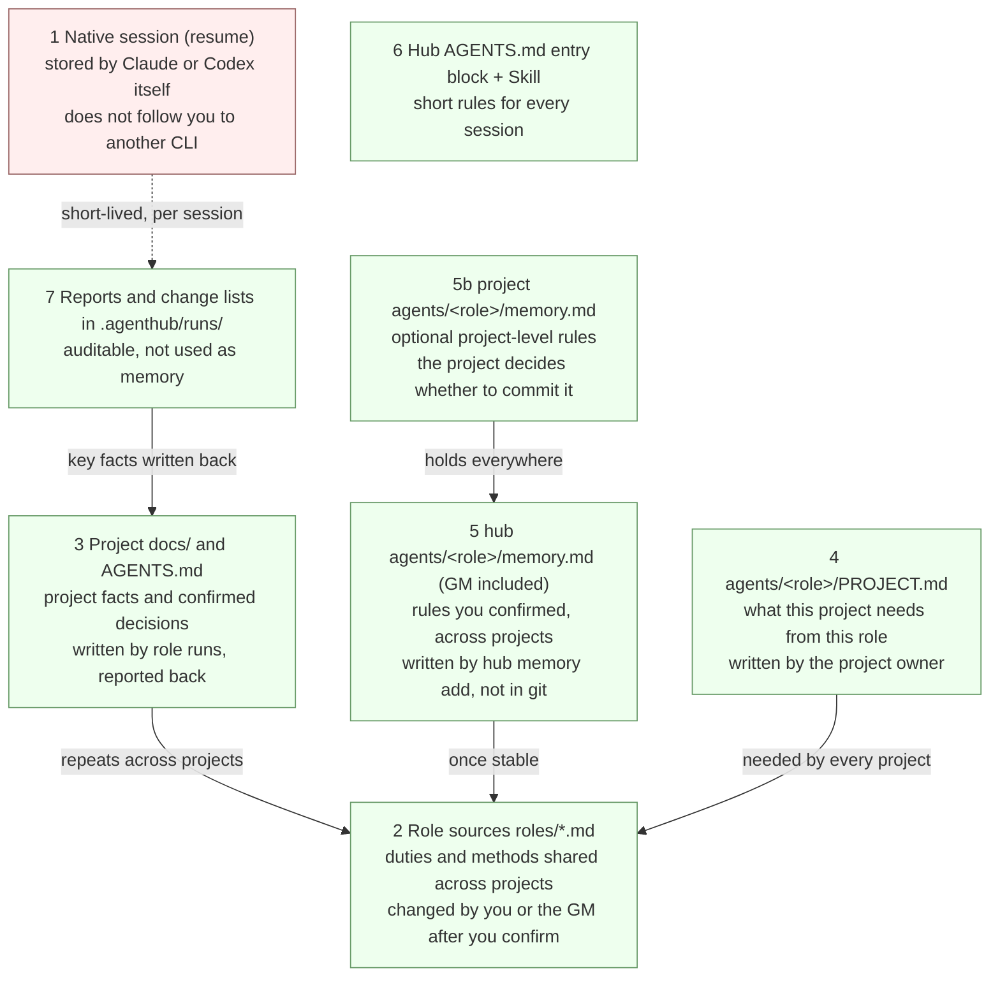

# AgentHubCore

**English** | [简体中文](README.zh-CN.md)

**Nobody can watch three or four threads at once. Turn them into three or four chats with agents.**

You tell one general-manager (GM) session what you want. It splits the work and hands it to roles such as
product, development, and QA: independent tasks run at the same time as background runs, each in its own copy
of your project; dependent tasks wait for the previous one and get its result. When everything is done it
brings back the results, the branches, and every question that needs your decision. It does not merge and it
does not accept work for you.

Roles are yours and work across all your projects. When you correct a role, the GM records it in that role's
memory, and the next project gets the corrected behaviour. The longer you use it, the more you keep: the memory
is a file in your hub, owned by you, not stored with any model provider, and it survives a change of CLI.


*The whole picture: you talk only to the GM; it has the PM write requirements first, runs Design and Dev in parallel, hands off to QA, brings the results back for you to decide, and role memory goes with you.*

## Highlights

1. **One conversation, a batch of workers.** Say what you want; the GM plans, dispatches roles, waits for all of
   them, reads every report, and gives you one summary table plus the branches to merge. Evidence: fan-out,
   relay, and mixed-result tests with fake runners (`npm test`); on real CLIs a Claude GM split one request into
   3 parallel Dev runs and 3 QA relays with `--worktree-of`, kept the three Dev runs alive at once, collected
   them with `hub wait`, and returned a 6-row table with all 6 memory proposals relayed, without merging or
   pruning. A Codex GM completed the same dispatch and collection, but the Codex roles it started could not run
   inside its sandbox (see Known limitations).
2. **Parallel where it can, serial where it must.** Unrelated tasks run at once; tasks that share a file or depend
   on each other go through one chain or hand over to another role on the same branch. Evidence: relay test
   (QA continues on the Dev branch with `--worktree-of`); GM card rules test.
3. **How many run at once is up to your machine and your model quota, not to hub.** No queue, no slots, no cap:
   every task is its own background process in its own copy. Evidence: 100 fake-runner runs alive at once and
   all collected (`npm run parallel-check -- --n 100 --sleep 15`, docs/testing.md); `npm run parallel-check`
   measures it on your own machine.
4. **Roles work across projects.** Define product, dev, and QA once, install them into any project anywhere,
   and let each project add its own requirements. Evidence: installer and dispatch-prompt tests; on real CLIs
   the same Dev role ran in two projects, on Claude Code and on Codex CLI.
5. **Memory that improves with use, and belongs to you.** Correct a role once; the GM repeats the rule, and
   after you confirm it records it in that role's memory, so the next project gets the corrected behaviour.
   Memory is a plain file in your hub: models read it on every run, but only `hub memory add` writes to it,
   after you confirm; it stays out of git by default, is not stored with any model provider, and works with
   either CLI. Evidence: cross-project memory test (`npm test`); on real CLIs a rule recorded through the GM for
   all projects was followed in another project by Dev on Codex CLI, on Claude Code, and in a worktree; a rule
   scoped to one project did not apply elsewhere; entries with an e-mail address or a home path were refused; with the stricter rules, both CLIs as GM recorded only after your agreement and handed refused entries back to you (one real-CLI session each).
6. **Every task reports back.** Which files changed, on which branch, what is still undecided; a failed run tells
   you the one step to take. Evidence: snapshot and report tests; 19 of 19 open questions relayed on real CLIs.
7. **Nothing is decided for you.** No merging, no accepting, no deleting branches; everything that needs you is
   asked, one item at a time. Evidence: GM card rules test; real-CLI GM runs in which the GM never answered for
   the user (docs/testing.md, v0.2 R8).

Claims without a test or a real run behind them are listed under [Known limitations](#known-limitations).

## What it works with

- Roles run on **Claude Code** or **Codex CLI**, chosen by one line in the role file; the GM seat works on either,
  and the GM and its roles may use different CLIs. A Codex GM can only dispatch roles that run on Claude Code
  (see Known limitations).
- Roles are yours to register: one `roles/<id>.md` in the hub is one role. GM, product, dev, and QA are built in;
  add more the same way.
- Projects stay where they are; installation is in place, nothing is moved.

## How a request becomes a batch of runs

```mermaid
flowchart TB
  U(("You")) -->|one request| GM["GM session<br/>writes the plan: parallel vs serial"]
  GM -->|"hub run --worktree ×N"| P1["run 1<br/>own worktree hub/run-1"]
  GM -->|at the same time| P2["run 2<br/>own worktree hub/run-2"]
  GM -->|at the same time| PN["run N<br/>own worktree hub/run-N"]
  GM -->|hub wait on all| W{"all finished?"}
  P1 & P2 & PN --> W
  W -->|yes| R["hub report, one by one"]
  R -->|dependent next step| S["relay run<br/>--worktree-of or resume"]
  S --> W
  R --> T["summary table: status, branch, changes, open questions<br/>branches to merge, in order"]
  T --> U
  U -->|after git merge| C["hub worktree prune"]
```



1. You say one thing to the GM. It writes a plan file in the hub (`.agenthub/batches/`): how many tasks, which run at the same time, which wait for another, who does each, and why. Its card tells it to show you that summary before anything runs; a Claude Code GM often shows it only at the end (see Known limitations), so the plan file is the place to look.
2. Tasks that can run at once each get a background run in their own copy of the project (a git worktree). There is no limit in `hub`; your machine and model quota set it.
3. Tasks that must happen in order wait: the GM waits for the earlier run, reads its report, and puts the result into the next task.
4. When everything has finished, the GM reads every report and gives you one table: what each task did, which files changed, on which branch, and what you need to decide.
5. Merging is yours. The GM lists the branches and a suggested order; it cleans up the copies only after you say they are merged or dropped.

## What it is

AgentHubCore is a zero-dependency Node CLI called `hub`. There is no server, daemon, database, or remote worker: roles, tasks, runs, logs, change lists, and memory are plain files you can read and keep in Git.

## Architecture



## Quick start

You need Node.js 20+ and a logged-in `claude` and/or `codex` CLI. AgentHubCore is not published to npm; run it from a clone.

```bash
git clone https://github.com/layyyback/AgentHubCore.git
cd AgentHubCore
export PATH="$PWD/bin:$PATH"   # `hub` for this shell and every session started from it
command -v hub

# Create a hub: entry block, .project-root, built-in roles (gm, pm, dev, qa), skill, role cards
HUB="$(mktemp -d)/hub"
hub init --hub "$HUB"

# Install into a project; real projects can live anywhere
PROJECT="$(mktemp -d)/demo"
cp -R examples/project "$PROJECT"
hub install --hub "$HUB" --project "$PROJECT"
hub check --project "$PROJECT"

# Dispatch a background run; --project is always explicit
RUN_ID="$(hub run --hub "$HUB" --project "$PROJECT" --role pm --task 'Write three acceptance criteria for this demo into acceptance.md')"
hub board --hub "$HUB"
hub wait --hub "$HUB" "$RUN_ID" --timeout 600   # up to 10 minutes; exit 2 = still running, check hub board
hub report --hub "$HUB" "$RUN_ID"

# Continue the same native conversation
NEXT_ID="$(hub resume --hub "$HUB" "$RUN_ID" --task 'Check that every criterion is testable')"
hub wait --hub "$HUB" "$NEXT_ID" --timeout 600
hub report --hub "$HUB" "$NEXT_ID"
```

`export PATH` writes nothing outside the clone but lasts only for this shell; to keep it, add the same line with the clone's absolute path to your shell profile. Alternatively, `npm link` puts `hub` on `PATH` for every terminal by writing a link into npm's global directory. Do not use a shell function or alias for `hub`: a GM session runs commands through its own tool and only sees `PATH`. The package name in `package.json` stays `agenthub-core` (lower-case, hyphenated) because it is never published; the project is called AgentHubCore.

## Daily use: talk to the GM

Day to day you do not type `hub run` yourself. Open a session in the hub root (`cd "$HUB" && claude`, or `codex`) from a shell where `hub` is on `PATH`, and say what you want. The entry block makes that session the GM.

Claude Code asks before running `hub` by default, and a non-interactive session (`claude -p`) simply refuses it. Allow it in either of two ways:

- add the rule to the hub's project settings, `<hub>/.claude/settings.json`:

  ```json
  { "permissions": { "allow": ["Bash(hub:*)"] } }
  ```

- or start the session with `claude --allowedTools "Bash(hub:*)"`.

Rules match the start of the command, so the GM calls `hub` without an environment-variable prefix (`HUB=… hub run` would be refused). The GM does not run `git` itself: it reads project state from `hub report`, `hub worktree list`, and `hub board`, and gives you commands such as `git log main..hub/<run>` to run yourself.

If the GM should read a project outside the hub, also pass `--add-dir <project>`. Codex runs `hub` under its own sandbox and approval settings; a non-interactive Codex session (`codex exec`) started in a hub that is not a git repository also needs `--skip-git-repo-check`.



A completed run is not finished business, and neither is accepted work. The GM reports what happened and asks you; it does not accept on your behalf.

## Hub and projects

Role sources live in the hub; knowledge lives in each project. Generated files can be reinstalled and are locked; files the project writes are never touched.



`hub install` replaces only the marked block in the project's `AGENTS.md`. A missing `AGENTS.md` needs `--create`. The installer never writes `CLAUDE.md`: a root `CLAUDE.md` that only says `@AGENTS.md` is removed, any other content is kept with a hint to merge it. Files a previous install created but no longer generates are deleted if untouched, kept and untracked if edited. `--roles a,b` installs a subset.

## Parallel work with worktrees



- The project must be the root of a git repository with at least one commit.
- A worktree contains committed files only. Commit the installed `agents/<role>/AGENTS.md` first; `hub run` warns if you have not.
- `hub worktree prune` removes finished worktrees, refuses ones with uncommitted changes unless `--force`, and always keeps the branch.
- `hub wait <run> [<run> ...]` waits for a whole batch and exits 0 (all completed), 1 (some failed or canceled), or 2 (still running after `--timeout`, default 100 s; call it again).
- `hub run --worktree-of <run>` lets another role continue on that run's branch once it has finished, for example QA checking a Dev branch. Runs sharing one worktree are serial.
- `npm run parallel-check` measures how many runs your machine carries at once: fake runners by default (`--n`, `--sleep`), real CLIs with `--real --yes` (that costs model calls).

## Memory layers

Where should something be remembered? Pick the lowest layer that is still true everywhere it applies.



Role memory lives in the hub, `<hub>/agents/<role>/memory.md`, so it follows the role into every project; every run reads it by absolute path, worktree runs included. Only `hub memory add` writes it, one dated line per rule, after a privacy check that refuses home paths, e-mail addresses, session ids, IP addresses, credentials, and your private word list. When you state a lasting rule, the GM repeats it, asks you to confirm, and stops there; it records the rule only after you say yes in a later reply (`hub memory add --confirmed`). If the privacy check refuses an entry, the GM tells you which rule refused it and asks you to reword it. When a role ends its report with `## Memory proposals`, the GM relays them and records only the ones you approve. Role cards tell roles not to edit memory themselves. The hub's `.gitignore` keeps `agents/*/memory.md` out of Git; a project may keep its own optional `agents/<role>/memory.md` and decide whether to commit it.

## Commands

```text
hub init --hub <hub>
hub roles build --hub <hub>
hub install --hub <hub> --project <project> [--roles a,b] [--create] [--force]
hub check --project <project>
hub diff --hub <hub> --project <project> [--roles a,b] [--create]
hub run --hub <hub> --project <project> --role <id> (--task <task> | --task-file <path>) [--worktree | --worktree-of <run>]
hub wait --hub <hub> <run> [<run> ...] [--timeout <seconds>] [--json]
hub status --hub <hub> [run]
hub report --hub <hub> <run>
hub resume --hub <hub> <run> (--task <task> | --task-file <path>)
hub cancel --hub <hub> <run>
hub board --hub <hub> [--hours <n> | --all] [--json]
hub worktree list --hub <hub> [--json]
hub worktree prune --hub <hub> [--run <id>] [--force]
hub memory add --hub <hub> --role <role> --text "<one line>" --confirmed [--project <name>]
hub memory list --hub <hub> --role <role> [--json]
```

Inside a hub (its root or any directory below it) `--hub` can be left out: `hub` finds the hub by the entry block in its `AGENTS.md`. Outside a hub, pass `--hub`.

Every dispatch prompt ends with three working-discipline lines: report real exit codes, write evidence to a file as you go, and say plainly what was not done.

## Role sources

A role is a Markdown file with a small front matter block:

```markdown
---
id: dev
name: Developer
description: Implements scoped changes and verifies them.
runner: codex-cli
workspace: project
---

# Developer

Write the role's instructions here.
```

Fields: `id`, `name`, `description`, `runner` (`claude-code` or `codex-cli`), optional `model`, `workspace` (`home` starts in the role's own directory, `project` starts in the project root), and optional `kind` (`role` or `entry`). An `entry` role such as the GM has no runner and cannot be dispatched. Never edit `agents/*/AGENTS.md` by hand; edit `roles/*.md` and run `hub roles build`.

## Making changes take effect

Three states are easy to confuse:

1. **Source changed**: you edited `roles/<id>.md`.
2. **Files installed**: `hub roles build` regenerated the hub's cards, and `hub install` copied them into each project.
3. **Sessions re-read**: a session that is already open keeps what it read at start. Start a new session, or tell it to re-read its card.

`hub run` rebuilds the hub's role cards before each dispatch; project copies change only when you run `hub install` again.

## Loading order and identity

- A session started in the hub root with no bound role is the GM; the entry block sends it to `agents/gm/AGENTS.md`.
- A session started in `agents/<role>/` reads that role's `AGENTS.md`.
- A session started in a project reads the project's `AGENTS.md`; the dispatch prompt then points to `agents/<role>/AGENTS.md`, `PROJECT.md`, and `memory.md`.

Three conventions keep identities apart: upper-level rules give way; the role card owns identity; the project layer holds facts and boundaries only. Details and a diagram are in [docs/how-it-works.md](docs/how-it-works.md).

## Known limitations

- **Parallelism has no ceiling in `hub`, but it has one on your machine.** Each run is a separate CLI process using CPU, memory, and model quota; runs can fail with rate-limit or quota errors and the GM must stop and report, not retry. Runs that share one worktree are serial. There is no automatic merge: you merge the branches. Two runs without `--worktree` in the same project can overwrite each other; `hub run` only warns.
- **Roles not editing memory is a rule, not enforcement.** Role cards tell roles to propose memory rather than edit `memory.md`, but a home-workspace role runs inside the hub and could change it; check `git diff` (if your hub is in git) or `hub memory list` now and then.
- **Batch planning and memory recording are GM card rules, and not all of them hold on real CLIs.** In real-CLI retests of the stricter rules, both a Claude Code GM and a Codex GM recorded memory only after you agreed in a later reply and handed a refused entry back to you for rewording (one four-turn session each). Showing the plan summary before dispatching held for a Codex GM but not for a Claude Code GM (0 of 2: it wrote the plan file, dispatched, and gave the summary only at the end). A Codex GM once put the open questions and memory proposals into a summary file instead of relaying them in the conversation; the card now forbids that, and this has not been retested on real CLIs since. For batches that matter, read the plan file in the hub's `.agenthub/batches/` and check memory with `hub memory list`.
- **A Codex GM cannot dispatch roles that run on Codex.** Inside Codex's default sandbox a nested `codex exec` fails to initialise (reproducible without hub, codex-cli 0.162.1). A Codex GM can dispatch roles that run on Claude Code. To work with Codex roles, either set the roles a Codex GM dispatches to `runner: claude-code` in `roles/<id>.md` (then `hub roles build`), or use a Claude GM, or run `hub run` from a normal terminal.
- **Permissions are conventions, not enforcement.** The boundaries in a role card are instructions to the model. Real permissions come from your local CLI configuration.
- **Only Claude Code and Codex CLI.** Both must be installed and logged in locally. Real smoke tests call models and cost money, so they are not part of `npm test`.
- **The GM needs `hub` on `PATH`.** A GM session runs `hub` through its own command tool, which sees `PATH` but not shell functions or aliases.
- **Claude Code must be allowed to run `hub`.** Its default permissions block the command, and non-interactive sessions refuse it outright; allow `Bash(hub:*)` as shown under Daily use; the GM does not run `git`, so no `git` rule is needed.
- **The GM's relay is a rule in its card, not code.** With the rule, the GM relayed every open question in 4 of 4 real-CLI runs, but a model can still skip one. For decisions that matter, read `hub report` yourself.
- **Native `AGENTS.md` loading needs a recent Claude Code** (2.1.277 or later, and no `CLAUDE.md` in the same directory). Verified on real CLIs for v0.2 (Claude Code 2.1.314, Codex CLI 0.162.1): both CLIs started in `agents/<role>/` load that role card natively, and each gives the same card-specific answer when started in the other role's directory. Codex reads from the project root; if your hub is not a git repository, add `.project-root` to Codex's `project_root_markers`.
- **Worktree runs: you commit and merge.** Verified on real CLIs: a Claude Code run and a Codex CLI run in parallel worktrees left the main working tree clean, and `resume` returned to the same worktree and native session. Codex's default sandbox does not allow `git commit` inside a worktree (its git data lives in the main repository's `.git`), so committing and merging are up to you.
- **No progress percentages.** `hub board` reports status, elapsed time, and the last event. A `completed` run is not finished business and not accepted work.
- **Local files only.** State is plain files on one machine with no distributed consistency. Closing the terminal does not stop a background run; use `hub cancel`.
- **Not on npm.** Run from a clone, or use `npm link`.

## Testing

```bash
npm test       # unit + fake-runner end-to-end tests; no model calls
npm run smoke  # real Claude Code and Codex CLI runs with resume; costs money
npm run scan   # personal-data scan of tracked files
npm run parallel-check -- --n 20   # how many runs your machine carries at once (fake runners; add --real --yes for real CLIs)
```

Results and the exact commands behind each release are recorded in [docs/testing.md](docs/testing.md). CI runs `npm test`, a role-card consistency check, and `npm run scan` on Node 20 and 22.

## Contributing and privacy

This repository is public. `npm run scan` checks every tracked file for home-directory paths, e-mail addresses, session ids, IP addresses, credential assignments, and local runtime paths, plus an optional private word list that never enters the repository (local file `.local/scan-patterns.txt`, or the `HUB_SCAN_PATTERNS` secret in CI). Hits are printed as `file:line:rule` only. The project rules for maintainers and agents are in [AGENTS.md](AGENTS.md); the release history is in [CHANGELOG.md](CHANGELOG.md).

## License

[MIT](LICENSE) © AgentHub Core contributors
