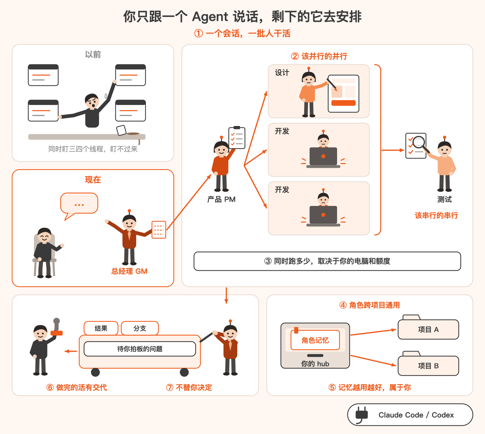
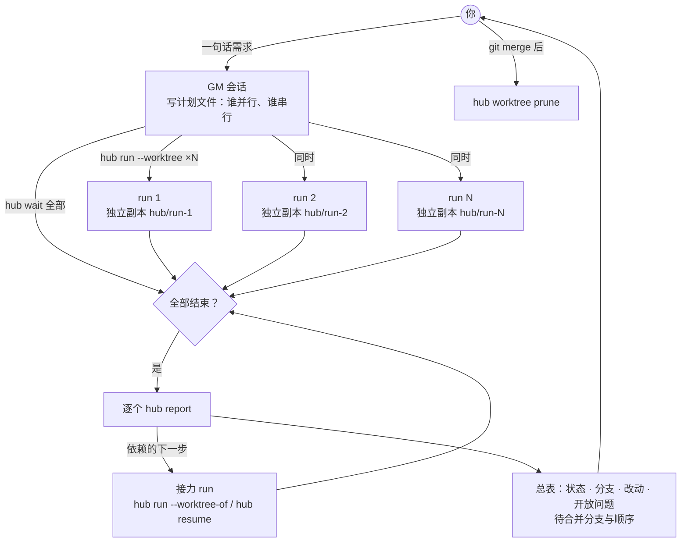
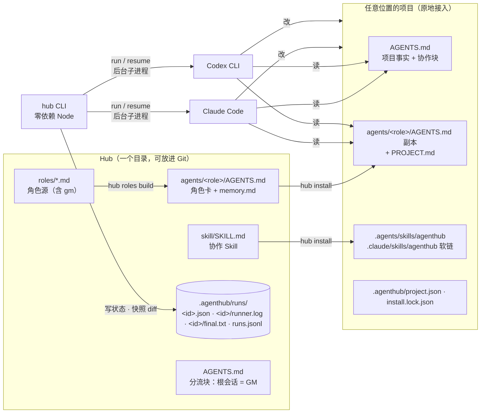
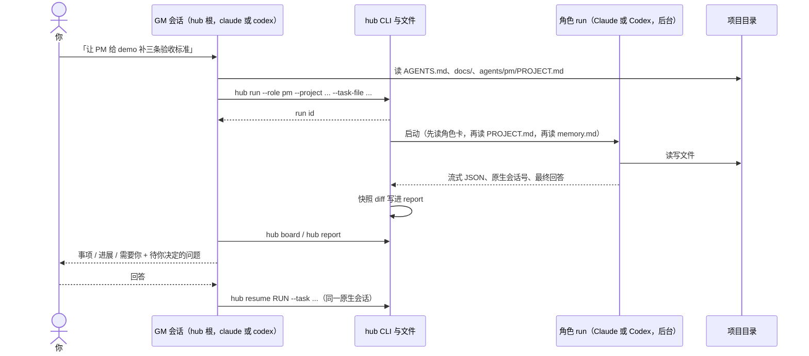
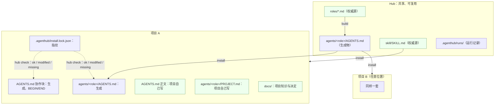
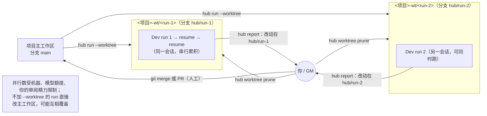
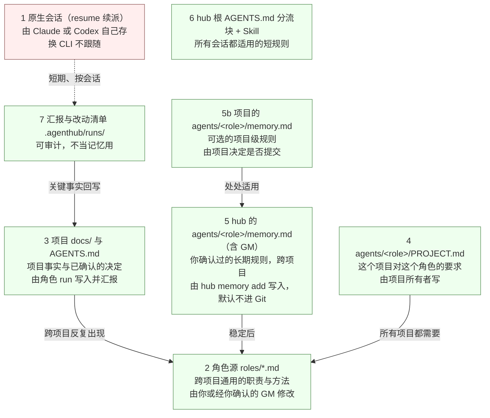

# AgentHubCore

[English](README.md) | **简体中文**

**同时盯着三四个线程，谁都盯不过来。把它们变成跟三四个 Agent 聊天。**

你只对一个总经理（GM）会话说要做什么。它把事情拆开，去找产品、开发、测试这些角色干活：能同时做的
就同时开几个后台任务，各自在你项目的一份独立副本里改；有先后的就等前一个做完、把结果交给下一个。
全部做完，它把结果、分支和每一个要你拿主意的问题带回来，不替你合并，也不替你验收。

角色是你定义的，一套角色在所有项目里通用。你纠正过的做法会记进这个角色的记忆，下次换一个项目照样
生效。用得越久，沉淀越多；这些沉淀是你 hub 里的文件，属于你，不存在任何模型服务商那里，换一个 CLI 也还在。



*一张图看懂：你只跟一个 GM 说话，它让产品先出需求、设计和开发并行、测试接力，再把结果带回给你拍板，角色记忆跟着你走。*

## 亮点

1. **一个会话，一批人干活。** 你说一句话，GM 出计划、派角色、等全部结束、逐个读汇报，给你一张总表和待合并
   的分支。证据：假 runner 的扇出、接力、混合结果测试（`npm test`）；真机：Claude GM 把一句话拆成 3 个并行 Dev 加
   3 个 `--worktree-of` 接力 QA，三个 Dev 同时在跑，用 `hub wait` 回收，6 行总表、6/6 条记忆提议逐条转述，不合并、
   不清理。Codex GM 走完同样的派发与回收流程，但它派出的 Codex 角色在本机沙箱里起不来（见已知限制）。
2. **该并行的并行，该串行的串行。** 互不相关的任务同时跑；共用一个文件或有依赖的，走同一条链或在同一分支上
   换角色接力。证据：接力测试（QA 用 `--worktree-of` 在 Dev 的分支上接着做）；GM 卡规则测试。
3. **同时能跑多少，取决于你的电脑和模型额度，不是 hub。** hub 没有队列、槽位和上限；每个任务都是独立的
   后台进程和独立副本。证据：假 runner 100 个同时存活并全部回收（`npm run parallel-check -- --n 100 --sleep 15`，
   见 docs/testing.md）；`npm run parallel-check` 让你在自己机器上测。
4. **角色跨项目通用。** 产品、开发、测试角色定义一次，装进任何位置的项目，每个项目还能给角色加自己的要求。
   证据：安装器与派发提示测试；真机：同一个 Dev 角色在两个项目里各跑通，换成 Claude 或 Codex 都一样。
5. **记忆越用越好，而且属于你。** 你纠正一次，GM 先复述、经你确认后记进这个角色的记忆；下次在别的项目里，
   这个角色照做。记忆是你 hub 里的一个普通文件：每次派单时模型会读它，但只有 `hub memory add` 在你确认后才
   往里写；它默认不进 Git，也不存在任何模型服务商那里，换一个 CLI 照样生效。证据：跨项目记忆测试（`npm test`）；真机：经 GM 记下的一条「所有项目」规则，
   在另一个项目里被 Codex 跑的 Dev、Claude 跑的 Dev、worktree 里的 Dev 都照做了；只限一个项目的规则在别的项目不生效；
   含邮箱或家目录路径的条目被拒绝写入；加严后，两种 CLI 当 GM 都是你同意后才记、被拒的条目交给你改写（真机各 1 次）。
6. **做完的活有交代。** 每个任务汇报改了哪些文件、在哪个分支、还有什么没定；失败了告诉你该做哪一步。
   证据：快照与报告测试；真机 19/19 条开放问题逐条带回。
7. **什么都不替你决定。** 不合并、不验收、不删分支；要你定的事逐条问你。证据：GM 卡规则测试；真机 GM 走通里
   GM 从未替用户作答（docs/testing.md，v0.2 R8）。

没有测试或真机证据支撑的说法，一律放在[已知限制](#已知限制)。

## 支持什么

- 角色可以跑在 **Claude Code** 或 **Codex CLI** 上，在角色文件里一行指定；GM 席位两种 CLI 都能坐，GM 和它派出的
  角色可以用不同的 CLI。Codex 当 GM 时只能派 Claude Code 跑的角色（见已知限制）。
- 角色是你自己注册的：hub 里一个 `roles/<id>.md` 就是一个角色，内置了 GM、产品、开发、测试四个，照样子加就行。
- 项目放在哪里都行，原地接入，不搬代码。

## 一句话怎么变成一批 run



1. 你对 GM 说一句话。GM 先在 hub 里写好计划文件（`.agenthub/batches/`）：几个任务、哪些同时跑、哪些要等前一个、每个派给谁、为什么。它的角色卡要求在任何任务开跑之前先把摘要给你看；Claude Code 当 GM 时常常到最后才给（见已知限制），所以请以计划文件为准。
2. 能同时跑的任务，每个开一个后台 run，各自在项目的一份独立副本（worktree）里干活。开多少个没有人为上限，取决于你的电脑和模型额度。
3. 必须先后做的任务，GM 等前一个结束、读完它的汇报，把结果写进下一个任务书再派。
4. 全部做完后，GM 逐个读汇报，给你一张总表：每个任务做了什么、改了哪些文件、在哪个分支、有什么问题要你定。
5. 合并由你决定。GM 列出待合并分支和建议顺序；你说合并完了或不要了，GM 才清理副本。

## 它是什么

AgentHubCore 是一个叫 `hub` 的 Node 命令行工具，零依赖，没有服务、守护进程、数据库或远程 worker：角色、任务、run、日志、改动清单、记忆都是普通文件，可以直接看，也可以放进 Git。

## 架构



## 快速上手

需要 Node.js 20+，并已在本机登录 `claude` 和/或 `codex`。AgentHubCore 没有发布到 npm，从克隆的仓库直接运行。

```bash
git clone https://github.com/layyyback/AgentHubCore.git
cd AgentHubCore
export PATH="$PWD/bin:$PATH"   # 本 shell 及从它启动的所有会话都能直接用 hub
command -v hub

# 建一个 hub：分流块、.project-root、内置角色（gm、pm、dev、qa）、Skill、角色卡
HUB="$(mktemp -d)/hub"
hub init --hub "$HUB"

# 装进一个项目；真实项目放在哪里都行
PROJECT="$(mktemp -d)/demo"
cp -R examples/project "$PROJECT"
hub install --hub "$HUB" --project "$PROJECT"
hub check --project "$PROJECT"

# 后台派单；--project 必须写明
RUN_ID="$(hub run --hub "$HUB" --project "$PROJECT" --role pm --task '为这个示例写三条验收标准，保存到 acceptance.md')"
hub board --hub "$HUB"
hub wait --hub "$HUB" "$RUN_ID" --timeout 600   # 最多等 10 分钟；退出码 2 表示还在跑，看 hub board
hub report --hub "$HUB" "$RUN_ID"

# 回到同一段原生会话继续
NEXT_ID="$(hub resume --hub "$HUB" "$RUN_ID" --task '再检查一遍每条标准是否可验证')"
hub wait --hub "$HUB" "$NEXT_ID" --timeout 600
hub report --hub "$HUB" "$NEXT_ID"
```

`export PATH` 不往仓库外写任何东西，但只对当前 shell 有效；想长期使用，把这一行（换成仓库的绝对路径）加进 shell 配置文件。另一种做法是 `npm link`：它在 npm 的全局目录里写一个链接，所有终端都能用 `hub`。不要用 shell 函数或 alias 定义 `hub`：GM 会话通过自己的工具执行命令，只认 `PATH`。`package.json` 里的包名保持 `agenthub-core`（小写加连字符），因为不发布到 npm；项目名是 AgentHubCore。

## 日常用法：只对 GM 说话

平时你不用自己敲 `hub run`。在 `hub` 已经在 `PATH` 上的 shell 里，到 hub 根目录开一个会话（`cd "$HUB" && claude`，或 `codex`），直接说要做什么。分流块会让这个会话成为 GM。

Claude Code 默认执行 `hub` 前要先问你，非交互会话（`claude -p`）会直接拒绝。两种放行方式任选其一：

- 在 hub 的项目设置 `<hub>/.claude/settings.json` 里加上规则：

  ```json
  { "permissions": { "allow": ["Bash(hub:*)"] } }
  ```

- 或者启动时带上 `claude --allowedTools "Bash(hub:*)"`。

放行规则按命令开头匹配，所以 GM 调用 `hub` 时不加环境变量前缀（`HUB=… hub run` 会被拒绝）。GM 自己不跑 `git`：项目状态从 `hub report`、`hub worktree list`、`hub board` 拿，需要看提交时把 `git log main..hub/<run>` 这类命令交给你执行。

如果 GM 要读 hub 之外的项目目录，再加 `--add-dir <project>`。Codex 执行 `hub` 时按它自己的沙箱和审批设置来；用非交互的 `codex exec` 在不是 Git 仓库的 hub 里启动时，还要加 `--skip-git-repo-check`。



run 显示 completed 不等于事情办完，更不等于你已验收。GM 只汇报发生了什么并问你，不替你验收。

## Hub 与项目

角色源放在 hub，知识留在各自的项目里。生成的文件可以重装、有锁保护；项目自己写的文件安装器从不碰。



`hub install` 只替换项目 `AGENTS.md` 里带标记的那一块。项目没有 `AGENTS.md` 时要加 `--create`。安装器不写 `CLAUDE.md`：项目根的 `CLAUDE.md` 如果只有一行 `@AGENTS.md` 就删除，其他内容保留并提示你手动合并。以前装过、现在不再生成的文件，没手改就删除，手改过就保留并不再跟踪。`--roles a,b` 只装指定角色。

## 并行：worktree



- 项目必须是 Git 仓库根目录，且至少有一次提交。
- worktree 只包含已提交的文件。先提交安装进来的 `agents/<role>/AGENTS.md`；没提交时 `hub run` 会警告。
- `hub worktree prune` 删除已结束 run 的 worktree；有未提交改动时拒绝，除非加 `--force`；分支永远保留。
- `hub wait <run> [<run> ...]` 等一整批 run：退出码 0 = 全部 completed，1 = 有 failed 或 canceled，2 = 到 `--timeout`（默认 100 秒）还有没结束的，再调一次。
- `hub run --worktree-of <run>` 让另一个角色在那个 run 结束后接着在它的分支上做，比如 QA 检查 Dev 的分支。共用一个 worktree 的 run 串行。
- `npm run parallel-check` 测你的电脑同时能扛多少个 run：默认用假 runner（`--n`、`--sleep`），加 `--real --yes` 用真实 CLI（会产生模型调用）。

## 记忆分层

一件事该记在哪？选仍然普遍成立的最低一层。



角色记忆放在 hub 里，`<hub>/agents/<role>/memory.md`，跟着角色走进每个项目；每次 run 都用绝对路径读它，worktree 里的 run 也一样。只有 `hub memory add` 能写，一条规则一行、带日期，写之前做隐私检查：家目录路径、邮箱、会话号、IP、凭据和你的专属词表一律拒绝。你说出一条长期规则时，GM 复述一遍、请你确认，然后停下；你在后续回复里明确同意后，它才记下来（`hub memory add --confirmed`）。隐私检查拒绝某条时，GM 告诉你是哪条规则拒绝的，请你自己改写。角色在汇报末尾写 `## Memory proposals` 提议时，GM 逐条转给你，只记你批准的。角色卡要求角色自己不改记忆。hub 的 `.gitignore` 让 `agents/*/memory.md` 不进 Git；项目也可以有自己可选的 `agents/<role>/memory.md`，提不提交由项目决定。

## 常用命令

```text
hub init --hub <hub>
hub roles build --hub <hub>
hub install --hub <hub> --project <project> [--roles a,b] [--create] [--force]
hub check --project <project>
hub diff --hub <hub> --project <project> [--roles a,b] [--create]
hub run --hub <hub> --project <project> --role <id> (--task <task> | --task-file <path>) [--worktree | --worktree-of <run>]
hub wait --hub <hub> <run> [<run> ...] [--timeout <seconds>] [--json]
hub status --hub <hub> [run]
hub report --hub <hub> <run>
hub resume --hub <hub> <run> (--task <task> | --task-file <path>)
hub cancel --hub <hub> <run>
hub board --hub <hub> [--hours <n> | --all] [--json]
hub worktree list --hub <hub> [--json]
hub worktree prune --hub <hub> [--run <id>] [--force]
hub memory add --hub <hub> --role <role> --text "<one line>" --confirmed [--project <name>]
hub memory list --hub <hub> --role <role> [--json]
```

在 hub 里（根目录或它下面的任何目录）可以省略 `--hub`：`hub` 会按 `AGENTS.md` 里的分流块找到 hub。在 hub 外面仍要写 `--hub`。

每次派发的提示末尾固定带三条纪律：报真实的退出码；边做边把证据写进文件；做不到就直说没做。

## 角色源

角色就是一个带简短 front matter 的 Markdown 文件：

```markdown
---
id: dev
name: Developer
description: Implements scoped changes and verifies them.
runner: codex-cli
workspace: project
---

# Developer

在这里写角色说明。
```

字段：`id`、`name`、`description`、`runner`（`claude-code` 或 `codex-cli`）、可选 `model`、`workspace`（`home` 从角色自己的目录开工，`project` 从项目根开工）、可选 `kind`（`role` 或 `entry`）。`entry` 角色（比如 GM）不绑定 runner，也不能被派发。不要手改 `agents/*/AGENTS.md`；改 `roles/*.md` 后运行 `hub roles build`。

## 让改动生效

三种状态容易混：

1. **源已改**：你改了 `roles/<id>.md`。
2. **文件已装**：`hub roles build` 重新生成了 hub 里的角色卡，`hub install` 把它们复制进了各个项目。
3. **会话已重读**：已经打开的会话只记得开工时读到的内容。开一个新会话，或让它重新读角色卡。

`hub run` 每次派发前都会重新生成 hub 里的角色卡；项目里的副本只有再运行 `hub install` 才会更新。

## 加载顺序与身份约定

- 在 hub 根目录启动、没有绑定角色的会话是 GM；分流块让它去读 `agents/gm/AGENTS.md`。
- 在 `agents/<role>/` 启动的会话读该角色的 `AGENTS.md`。
- 在项目里启动的会话读项目的 `AGENTS.md`；派发提示再让它读 `agents/<role>/AGENTS.md`、`PROJECT.md` 和 `memory.md`。

三条约定把身份分开：上层规则让位；角色卡拥有身份主权；项目层只写事实和边界。细节和图见 [docs/how-it-works.md](docs/how-it-works.md)。

## 已知限制

- **`hub` 不设并行上限，你的电脑有。** 每个 run 都是一个独立的 CLI 进程，占 CPU、内存和模型额度；遇到限流或额度错误会失败，GM 要停手报告而不是重试。共用一个 worktree 的 run 串行。没有自动合并：分支由你合并。同一项目里两个不加 `--worktree` 的 run 可能互相覆盖，`hub run` 只打警告。
- **角色不改记忆是约定，不是强制。** 角色卡要求角色只提议、不改 `memory.md`；home 型角色的工作目录就在 hub 里，技术上能改到。偶尔用 `git diff`（如果 hub 在 Git 里）或 `hub memory list` 看一眼。
- **批量规划和记忆记录是 GM 卡里的规则，真机上不是每条都做到。** 加严后的真机复测：只有你在后续回复里同意才记录记忆、被隐私检查拒绝的条目交给你改写，Claude Code 和 Codex 当 GM 时都做到了（各 1 次，4 轮对话）；派发前先给计划摘要，Codex GM 做到了，Claude Code GM 两次都没做到（先写好计划文件就开派，摘要到最后汇总才给）。Codex GM 有一次把开放问题和记忆提议写进汇总文件，没在对话里逐条说；卡里已明确禁止，加严后未再真机复验。重要的批次，请看 hub 里 `.agenthub/batches/` 的计划文件，并用 `hub memory list` 核对记忆。
- **Codex GM 不能派 Codex 跑的角色。** 在 Codex 默认沙箱里，再起一个 `codex exec` 会初始化失败（不经 hub 也能复现，codex-cli 0.162.1）。Codex 当 GM 时，派给 Claude 跑的角色没问题。要用 Codex 角色，可以把 Codex GM 要派的角色在 `roles/<id>.md` 里设成 `runner: claude-code`（然后 `hub roles build`），或者用 Claude 当 GM，或者在普通终端里直接 `hub run`。
- **权限是约定，不是强制。** 角色卡里的边界是给模型的指示，实际权限取决于你本机 CLI 的配置。
- **只支持 Claude Code 和 Codex CLI。** 需要在本机安装并登录。真机冒烟会调用模型、产生费用，所以不在 `npm test` 里。
- **GM 需要 `hub` 在 `PATH` 上。** GM 会话通过自己的命令工具执行 `hub`，这个工具只认 `PATH`，看不到 shell 函数和 alias。
- **Claude Code 要放行 `hub`。** 默认权限会拦下这个命令，非交互会话直接拒绝；按「日常用法」一节放行 `Bash(hub:*)`；GM 不跑 `git`，不需要放行 `git` 命令。
- **GM 的转述靠角色卡规则，不是代码强制。** 加入规则后的真机测试里 4 次都把开放问题全部带回，但模型仍可能漏掉。重要的决定请自己看一眼 `hub report`。
- **原生读取 `AGENTS.md` 需要较新的 Claude Code**（2.1.277 及以上，且同目录没有 `CLAUDE.md`）。v0.2 已真机验证（Claude Code 2.1.314、Codex CLI 0.162.1）：两个 CLI 在 `agents/<role>/` 下启动时都原生读到该角色卡；换到另一个角色目录启动，两者给出的也是那张卡对应的答案。Codex 从项目根读起；hub 不是 Git 仓库时，要在 Codex 的 `project_root_markers` 里加上 `.project-root`。
- **worktree run：提交和合并由你来做。** 已真机验证：一个 Claude Code run 和一个 Codex CLI run 在各自的 worktree 里并行，主工作区保持干净，`resume` 回到同一 worktree、同一原生会话。Codex 默认沙箱不允许在 worktree 里 `git commit`（worktree 的 Git 数据在主仓的 `.git` 里），所以提交和合并由你来做。
- **没有进度百分比。** `hub board` 只报状态、耗时和最近事件。run `completed` 不等于事情办完，也不等于已验收。
- **只用本地文件。** 状态是一台机器上的普通文件，没有分布式一致性。关掉终端不会停止后台 run，要用 `hub cancel`。
- **没有发布到 npm。** 从克隆的仓库运行，或用 `npm link`。

## 测试

```bash
npm test       # 单元 + 假 runner 完整链，不调用模型
npm run smoke  # 真实 Claude Code 与 Codex CLI 的 run + resume；会产生费用
npm run scan   # 被跟踪文件的个人信息扫描
npm run parallel-check -- --n 20   # 你的电脑同时能扛多少个 run（假 runner；加 --real --yes 用真实 CLI）
```

每次发版背后的命令和结果记在 [docs/testing.md](docs/testing.md)。CI 在 Node 20 与 22 上跑 `npm test`、角色卡一致性检查和 `npm run scan`。

## 参与与隐私

本仓公开。`npm run scan` 检查每个被跟踪文件里的家目录路径、邮箱、会话号、IP 地址、凭据赋值和本地运行路径，另可加一份永不进仓库的专属词表（本地文件 `.local/scan-patterns.txt`，或 CI 里的 `HUB_SCAN_PATTERNS` Secret）。命中只打印 `文件:行号:规则`。维护者与 agent 的项目规则见 [AGENTS.md](AGENTS.md)；版本历史见 [CHANGELOG.md](CHANGELOG.md)。

## 许可证

[MIT](LICENSE) © AgentHub Core contributors
