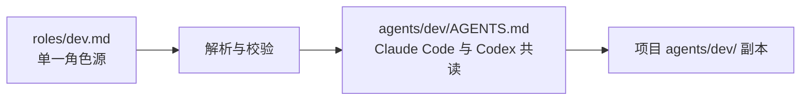
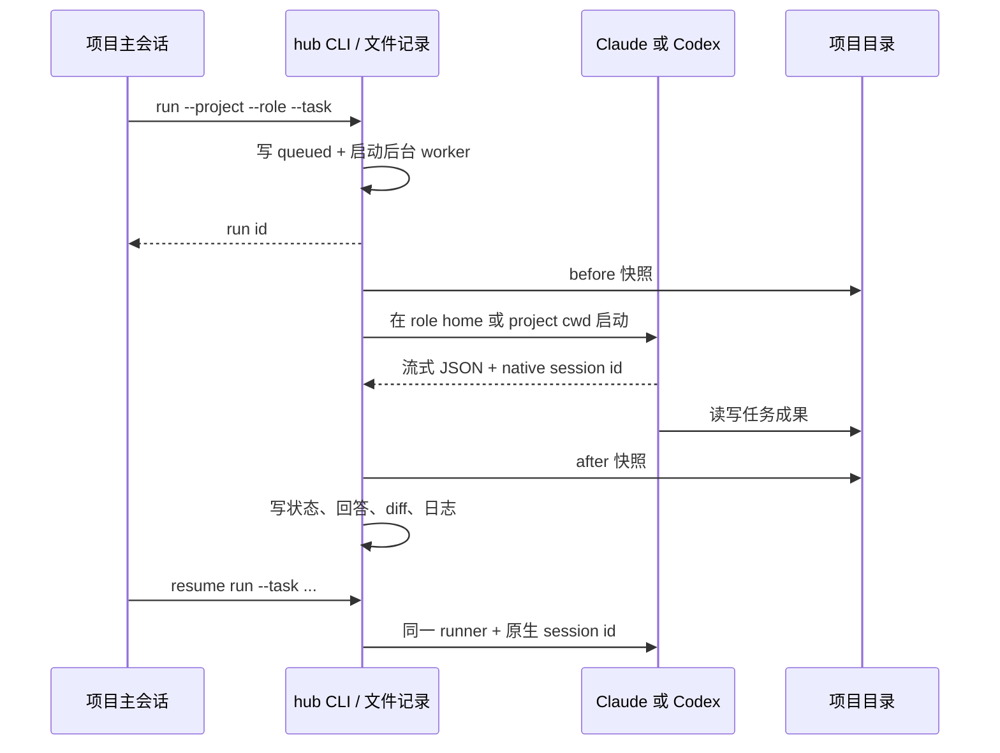
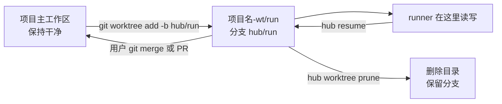
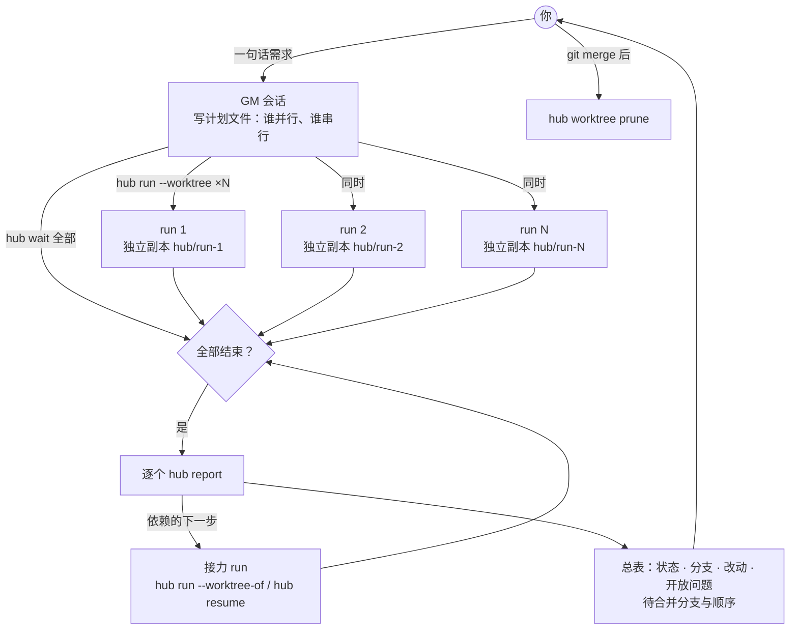
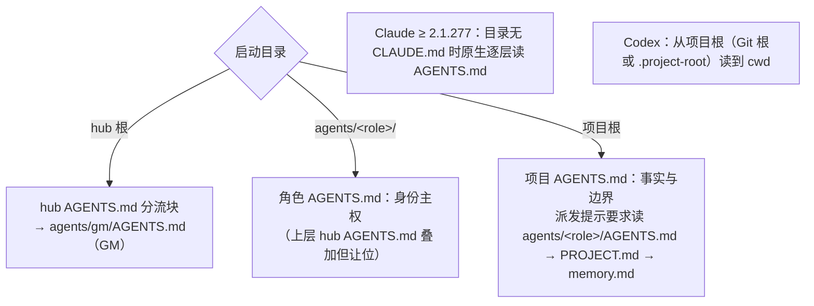

# 工作机制

## 角色同源

每个 `roles/*.md` 由简单 front matter 和 Markdown 正文组成。生成器只做校验与规范化，不做 runner 专属改写，只写一份 `agents/<id>/AGENTS.md`：生成头（注明来源、勿手改）+ 身份主权段（上级目录的 `AGENTS.md` 只描述工作区与项目事实，不定义你的角色）+ front matter + 正文。Claude Code 与 Codex 读的是同一个文件。

不再生成 `CLAUDE.md`：同目录有 `CLAUDE.md` 时 Claude 不读 `AGENTS.md`，两份文件会让换 runner 时加载内容分叉。`hub roles build` 遇到旧的生成副本（内容等于本次或上一次渲染结果）直接删除；手改过的保留、打印 `preserve` 提示，不再管理。

元数据可选 `kind: role | entry`（默认 `role`）。`entry` 是用户亲自开的会话读的卡（目前只有 GM），可以不写 `runner`，`hub run` 拒绝派发它。



## GM 入口

`hub init --hub <hub>` 在 hub 根写入（或更新）`AGENTS.md` 里带 `BEGIN/END AGENTHUB CORE ENTRY` 标记的分流块，块外文字归用户；同时写空文件 `.project-root`、`.gitignore`（`.agenthub/` 与 `agents/*/memory.md`），hub 里还没有角色源和 Skill 时从内置模板复制一份，最后生成角色卡。重复执行零写入，输出 `already up to date`。

这个分流块也是 hub 的标志：在 hub 根目录或它下面的任何目录里运行 `hub` 命令（`hub init` 除外）而不写 `--hub` 时，`hub` 从当前目录逐级往上找，第一个 `AGENTS.md` 里带这个分流块的目录就是 hub；找不到就报 `--hub is required`。

分流块的意思：正好在 hub 根启动、没有绑定角色的会话就是 GM，先读 `agents/gm/AGENTS.md`；在角色目录或项目里启动的会话不是 GM。GM 卡与其他角色卡同一套生成机制，不绑定 runner。GM 不走 `hub run`：它是用户直接对话的交互会话，派出去的 run 才是非交互的 `-p` / `exec`。

## 项目原地安装

安装器不移动项目。它在 `AGENTS.md` 中只替换带标记的协作块；块外文本由项目所有者维护。缺少 `AGENTS.md` 时需 `--create`，骨架写三条：开始工作先读 `docs/`；新决定写回本项目 `docs/`；产品代码只在本项目或其隔离工作副本中改。安装器不写 `CLAUDE.md`：项目根 `CLAUDE.md` 若只有一行 `@AGENTS.md` 就删除，其他内容保留并提示人工归并。锁里记着、这次不再生成的文件（如 v0.1 的 `agents/<id>/CLAUDE.md`，或 `--roles` 去掉的角色）未手改则删除，手改则保留并停止跟踪。`--roles a,b` 只装指定角色；默认装全部可派发角色，`entry` 角色不装进项目。Skill 的 Claude 入口是相对软链，因此项目整体移动后仍有效。

锁文件对普通生成文件记录完整 SHA-256，对 `AGENTS.md` 记录协作块 SHA-256。这样项目可以继续编辑块外事实，同时对生成区的手改保持可检测。`check` 将每项归为 `ok`、`modified` 或 `missing`；`install` 遇到手改拒绝覆盖，除非传 `--force`。

## 派单与恢复

`hub run` 先落一份 queued 记录，再启动一个分离的本地 Node worker。worker 在调用 runner 前取项目快照，解析 JSONL 流得到原生会话号与最终回答，结束后再取快照并写回结果。没有 HTTP 服务、守护进程或远端队列。

文件布局：`<hub>/.agenthub/runs/<id>.json` 是每个 run 的记录；`<hub>/.agenthub/runs/<id>/runner.log` 与 `final.txt` 是日志和最终回答；`runs.jsonl` 是所有 run 的摘要索引。



任务可以用 `--task` 直接给，也可以用 `--task-file <path>` 从文件读（二选一，路径记进 run 记录的 `task_file`）。派发提示按固定顺序要求角色读四样东西：角色卡；hub 里的角色记忆 `<hub>/agents/<role>/memory.md`（绝对路径，跨项目，worktree 里也读得到）；项目的 `agents/<role>/PROJECT.md`（只能收窄范围，不推翻角色卡）；项目的 `agents/<role>/memory.md`（可选的项目级规则）。`workspace: home` 的角色 cwd 在 hub 的 `agents/<role>/`，提示用项目绝对路径指向项目里的两个文件。提示末尾要求角色把「下次还该这样做」的事写在最终回答的 `## Memory proposals` 小节里、不要自己改任何 `memory.md`，最后是三条固定纪律：取真实退出码、做完一件就把证据落盘、做不到就说没做。`PROJECT.md` 归项目所有，安装器不生成、不锁、`check` 不看。

`resume` 会创建一条新的本地 run 记录，并用父 run 的原生会话号调用同一 runner；父子关系保留在 `parent_run_id`。这样每次派发都有独立日志和变更窗口，同时上下文仍是原生同一会话。

## 进度板：`hub board`

只读 `<hub>/.agenthub/runs/*.json` 与各 run 的 `runner.log` 末尾 64 KB，不起服务，不读提示和回答正文。默认列出进行中的 run 和 24 小时内有动静的 run；`--hours N` 改窗口，`--all` 全列，`--json` 给机器读。

第一行汇总：几个在跑、几个已结束、有没有失败要用户处理。之后每行一个 run，按项目分组：run 号、项目目录名、角色、runner、状态、已耗时、最近动作、来源（`new` / `resume`，用了 worktree 再加分支名）。最近动作只取事件类型：Claude 取 `assistant` 或 `tool_use <工具名>`，Codex 取 `item.completed <item 类型>`，截断 60 字。不算百分比，因为 run 没有可信的总工作量。

## 并行：`hub run --worktree`



- 前提：`--project` 是 Git 仓库根且至少有一次提交，否则报 `--worktree requires a git project`。
- 位置：`<项目父目录>/<项目名>-wt/<run-id>`，分支 `hub/<run-id>`，基于当前 `HEAD`。worktree 只含已提交的文件，所以安装产生的 `agents/<role>/AGENTS.md` 要先提交，角色才能在 worktree 里读到卡。
- run 记录多一个 `worktree: { path, branch }`；`cwd`、快照根和可写目录都换成 worktree，主工作区不被这个 run 改动。
- `resume` 复用父 run 的 worktree（同一会话串行累积改动）；父 worktree 已被删除时报错。
- `hub worktree list` 列出 run 记录里的 worktree、分支、目录是否还在。`hub worktree prune [--run <id>]` 只处理没有活跃 run 的 worktree，执行 `git worktree remove`；有未提交或未跟踪文件时拒绝（退出码 1），`--force` 才强删；分支永远保留。
- 合并由用户自己做：`git merge hub/<run-id>` 或开 PR。
- 不做并发守卫：不加 `--worktree` 的 run 启动时，若同一项目已有不在 worktree 里的活跃 run，只在 stderr 打警告，不阻止。
- 换角色接力：`hub run --role qa --worktree-of <run>` 让新 run 在 `<run>` 的 worktree 与分支上继续（例如 QA 检查 Dev 的分支）。来源 run 必须有 worktree、属于同一项目，且这个 worktree 上没有活跃 run（共用一个 worktree 的 run 串行）；新 run 记录 `worktree_from: <run>`。与 `--worktree` 互斥。

## 批量派发与回收



- 规划：需要多个 run 的需求，GM 先在 hub 写计划文件 `.agenthub/batches/<日期>-<名>.md`，告诉你几个任务、谁并行、谁等谁。互不依赖、不改同一文件、项目是有提交的 Git 仓库 → 并行（各开一个 `--worktree`）；需要前一个的结果、要改同一个文件、或项目不是 Git 仓库 → 串行。
- 等待：`hub wait --hub <hub> <run> [<run> ...] [--timeout <秒>] [--json]` 每秒读一次 run 记录，直到全部进入终态或超时。退出码 0 = 全部 completed，1 = 至少一个 failed / canceled，2 = 超时仍有未结束的（再调一次）。默认超时 100 秒，保证一次调用在 Claude Code、Codex 的命令超时之内返回，GM 不需要 shell 循环或 `sleep`。每个 run 输出一行 `id、状态、退出码、耗时、角色、分支`，最后一行是汇总；不输出提示和回答正文。
- 回收：GM 逐个读 `hub report`，给你一张总表，并逐条转述每份报告的开放问题、阻碍和记忆提议；失败的 run 引用 Runner error，不擅自重试。合并与 `prune` 都等你说了才做。
- 上限：`hub` 不设并行上限、没有队列和槽位。N=100 假 runner 压测（`npm run parallel-check -- --n 100 --sleep 15`）峰值并发 100、全部回收，见 `docs/testing.md`；真实上限取决于电脑和模型额度，用 `npm run parallel-check` 自己测。

## 角色记忆

- 主库在 hub：`<hub>/agents/<role>/memory.md`，跟着角色走，所以跨项目生效；`hub init` 写的 `.gitignore` 让它默认不进 Git。项目里的 `agents/<role>/memory.md` 是可选的项目级规则，由项目自己决定提不提交。
- 写入只有一条路：`hub memory add --hub <hub> --role <role> --text "<一行>" --confirmed [--project <项目名>] [--from user|<run>]`。不带 `--confirmed` 直接以退出码 1 拒绝、零写入：这是一道「减速带」，让写入成为用户明确同意之后单独的一步（GM 卡要求复述后结束本轮，用户在后续回复里同意才加这个参数），它不能识别是不是真的经过了同意。`--project` 传的是路径时只记目录名，绝对路径不会进记忆。每条一行：`- <日期> · from <user 或 run 号前 8 位> · project <id> | all projects: <规则>`。同文本已存在时输出 `already recorded`、零写入。写入前用与 `npm run scan` 相同的个人信息规则（家目录路径、邮箱、会话号、IP、凭据、本地运行目录，外加 hub 下 `.local/scan-patterns.txt` 或环境变量 `HUB_SCAN_PATTERNS` 里的专属词）检查这一行，命中就拒绝并以退出码 3 报规则名，不回显原文；hub `.gitignore` 缺那一行就补上并提示。
- 谁写：用户说出长期规则时，GM 复述、确认后用 `hub memory add` 记；角色在汇报末尾 `## Memory proposals` 里提议，用户批准的才记。角色自己不改 `memory.md`。`hub memory list [--json]` 查看；删改直接编辑文件。

## runner 参数与环境

- Claude Code：`-p --output-format stream-json --verbose`；恢复加 `--resume <id>`；home 型角色用 `--add-dir <project>`。
- Codex CLI：`exec --json --output-last-message`；恢复用 `exec resume <id>`。恢复命令没有工作目录参数，所以 fresh/resume 都使用子进程 `cwd`；额外可写根通过 `sandbox_workspace_write.writable_roots` 配置。
- 两者都继承普通环境和代理变量，但删除键名包含 `token / secret / password / key / cookie / credential / auth` 的变量。

## 成果快照

Git 项目用 NUL 分隔的 porcelain 状态，并给脏文件补内容 SHA-256。比较前后“状态 + 内容”可识别本来就脏但本轮未动的文件。非 Git 项目递归列文件并比较内容 SHA-256，也能报告新增、修改、删除。`.git`、`node_modules`、`.agenthub` 和环境文件被跳过。任何读取或 Git 错误都会进入 report 的 `Collection errors`。

## 加载层级

三层：

1. hub 根 `AGENTS.md`：只有 GM 分流块和用户自己的说明。
2. 角色目录 `agents/<role>/AGENTS.md`（home 型角色的 cwd）或项目根 `AGENTS.md`（项目事实与协作块）。
3. 项目里的 `agents/<role>/AGENTS.md` 角色副本 + 可选 `PROJECT.md`，由派发提示要求读取。



- Claude Code ≥ 2.1.277 在目录里没有 `CLAUDE.md` 时原生逐层读 `AGENTS.md`。
- Codex 从项目根（Git 根，或带标记文件的目录）读到 cwd。hub 不是 Git 仓库时，在 Codex 用户配置（`~/.codex/config.toml`）里加一行，`hub init` 写的 `.project-root` 才会被认作根：

```toml
project_root_markers = [".git", ".project-root"]
```

三条约定是：上层规则让位；角色卡拥有身份主权；中间项目层只写事实，不另定义角色。
